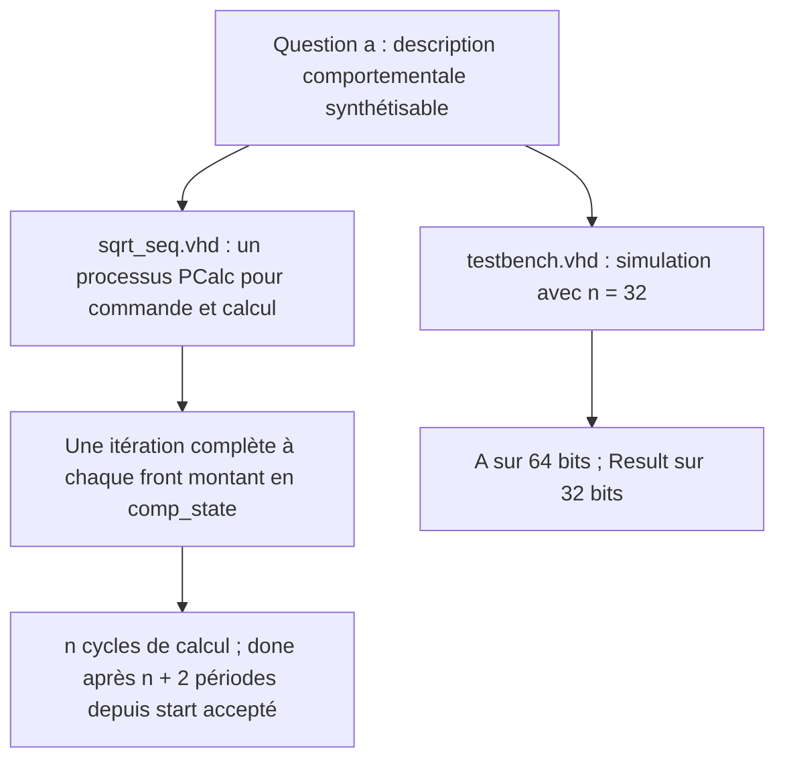
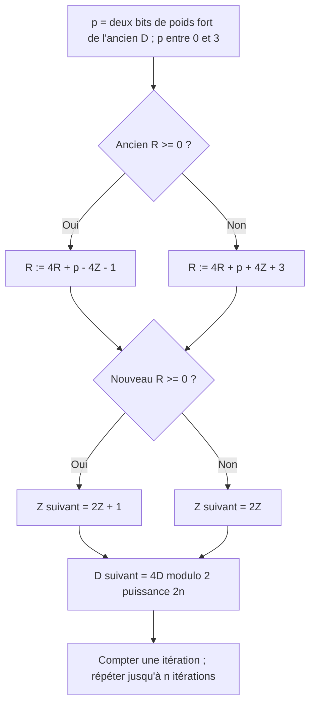
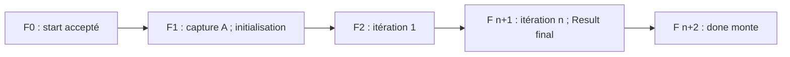

# QA — Architecture séquentielle comportementale

Ce guide explique `sqrt_seq.vhd` et `testbench.vhd` en réponse à la question a du sujet. Les blocs Mermaid se lisent dans l'aperçu Markdown d'un éditeur compatible Mermaid. Le circuit calcule **Result = partie entière de sqrt(A)** : Result² ≤ A < (Result+1)². Le paramètre n est le nombre de bits du résultat et le nombre d'itérations ; n doit être au moins 1.

## 1. Du sujet aux fichiers

`PCalc` contient les quatre états et les opérations. `Result <= std_logic_vector(Z)` expose le registre Z par un fil concurrent. Le testbench est réservé à la simulation : ses délais ne font pas partie du matériel synthétisable.

## 2. Les données mémorisées

| Élément | Largeur | Fonction |
|---|---|---|
| A | 2n bits, non signé | Entrée, capturée pendant init_state |
| D | 2n bits, unsigned | Copie de A, décalée de deux bits à chaque itération |
| Z | n bits, unsigned | Racine partielle, puis résultat |
| R | n+2 bits, signed | Reste partiel, éventuellement négatif |
| i | entier de 0 à n−1 | Compteur croissant des itérations |
| curr_state | quatre états | Phase du traitement |

Pour n=32 : D et A ont 64 bits, Z et Result 32 bits, R 34 bits. `numeric_std` définit les opérations numériques ; les conversions et `resize` alignent les types et largeurs. R est une variable locale au processus qui **conserve sa valeur entre les fronts** : elle représente bien une mémoire.

## 3. Une itération de l'algorithme

Chaque passage consomme une paire de bits de A, de la plus forte à la plus faible, et produit un bit de racine. La division entière du sujet par 2^(2n−2) est une extraction de bits ; les multiplications par 2 ou 4 sont des décalages constants.

Le premier test utilise l'ancien R. L'affectation `R := ...` prend effet immédiatement : le second test voit le nouveau R **dans la même exécution**. Les affectations `Z <= ...` et `D <= ...` prennent effet après le processus : les équations lisent donc l'ancien Z et l'ancien D. Remplacer simplement R par un signal ferait lire l'ancien reste au second test.

Les calculs sont réalisés à largeur fixe. R final tient dans n+2 bits : après k itérations, 0 ≤ Z ≤ 2^k−1 et −(2Z+1) ≤ R ≤ 2Z. Les intermédiaires peuvent déborder ; les bits conservés représentent le résultat modulo 2^(n+2).

## 4. Automate réel du code

Les actions ci-dessous sont celles exécutées au front lorsque l'état courant est celui indiqué.

```mermaid
stateDiagram-v2
    [*] --> wait_state: rst = 1 impose cet état
    wait_state: done=0 ; R=D=Z=0 ; i=0
    init_state: D=A ; R=Z=0 ; i=0 ; done=0
    comp_state: Une itération ; done=0
    end_state: done=1 ; conserver le résultat
    wait_state --> wait_state: start=0
    wait_state --> init_state: start=1
    init_state --> comp_state: Front suivant
    comp_state --> comp_state: i inférieur à n-1 ; i augmente
    comp_state --> end_state: i=n-1 ; dernière itération
    end_state --> end_state: start=1
    end_state --> wait_state: start=0
```

Le reset asynchrone ne force directement que `curr_state`. Les données et `done` sont initialisés au front exécutant ensuite `wait_state`. Avant ce front, certaines sorties peuvent être indéfinies. A doit rester stable jusqu'au front qui exécute init_state. Une impulsion start acceptée en attente suffit ; garder start à 1 maintient l'état final. Après le retour en attente, l'exécution de wait_state efface Z.

## 5. Nombre de cycles et test présent

F0 est l'origine des intervalles de temps : le calcul prend n cycles ; le résultat final arrive après n+1 périodes et done après n+2 périodes. Pour n=32 et T=20 ns, cela fait 640 ns de calcul et 680 ns entre start accepté et done. Ce sont des durées de simulation, pas une mesure de fréquence maximale FPGA.

Le testbench génère un reset de 0 à 5 ns, une horloge de période 20 ns, puis deux calculs :

| A | start accepté | Capture de A | Dernière itération | done=1 | Résultat |
|---|---|---|---|---|---|
| 100 | 30 ns | 50 ns | 690 ns | 710 ns | 10 |
| 25 | 810 ns | 830 ns | 1470 ns | 1490 ns | 5 |

Ces valeurs sont déduites du code. Ce banc ne comporte pas d'assertions : contrôler Result lorsque done=1 dans les chronogrammes. Pour une simulation ModelSim rapide, se placer dans QA, exécuter `vlib work`, puis `vcom -93 sqrt_seq.vhd testbench.vhd`, `vsim work.testbench`, `add wave sim:/testbench/*` et `run -all`. L'horloge s'arrête après 100 périodes.

## 6. Ce que QA démontre

Le code répond à la structure demandée en a : commande et calcul dans un processus, une itération par cycle, paramètre n et banc à n=32. Les deux cas présents servent à une vérification visuelle ; ils ne couvrent pas toute l'entrée 64 bits. La question c demande ensuite une implémentation FPGA et des mesures de fréquence et de ressources : ces mesures ne sont pas fournies par une simulation fonctionnelle.
