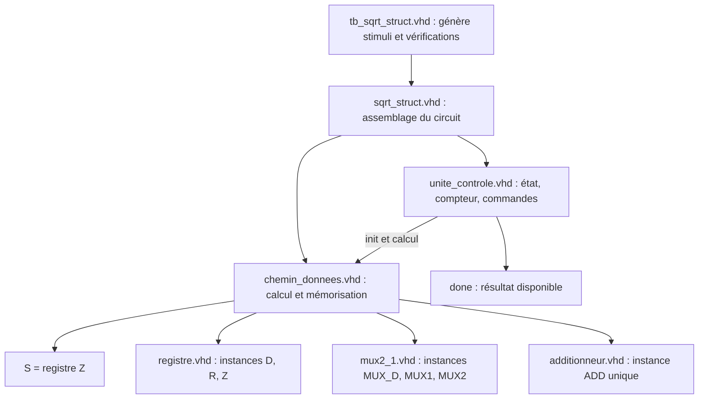
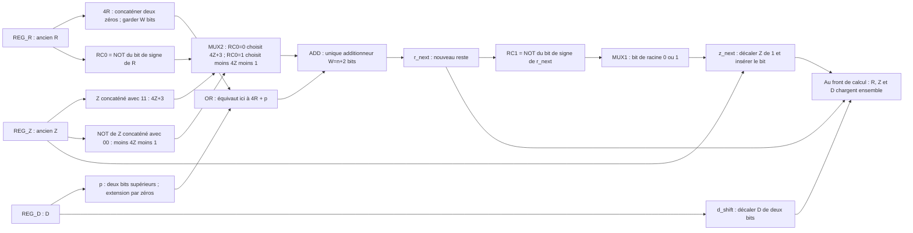
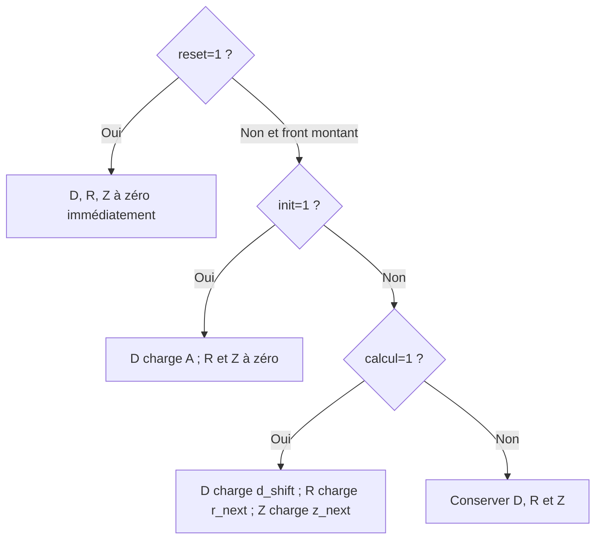
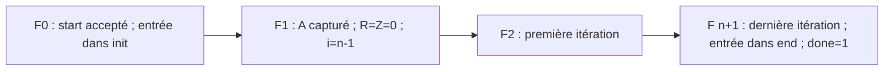
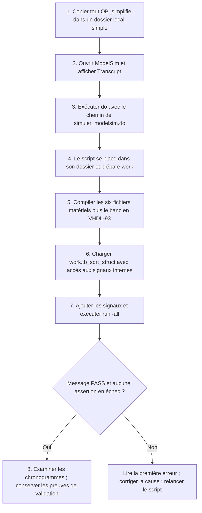

# QB — Architecture structurelle et simulation ModelSim

Ce guide explique les fichiers de `QB_simplifie` en réponse à la question b. Les diagrammes Mermaid se lisent dans un aperçu Markdown compatible Mermaid. Objectif : calculer S = partie entière de sqrt(A), avec **un seul additionneur dans le chemin de données**, des entités séparées et une itération par cycle. Pour n=32, A a 64 bits, S 32 bits et le reste 34 bits. n doit être au moins 1.

## 1. Organisation des fichiers



Le sommet ne contient que des instances et leurs connexions. Le banc de test est un environnement de simulation ; il ne se synthétise pas. `simuler_modelsim.do` compile les fichiers dans l'ordre, lance le banc et prépare les chronogrammes.

## 2. Transformer l'algorithme en matériel

À chaque itération, avec p égal aux deux bits supérieurs de D :

- Si l'ancien R ≥ 0 : R suivant = 4R + p − (4Z+1).
- Sinon : R suivant = 4R + p + (4Z+3).
- Selon le signe du **nouveau** R : Z suivant = 2Z+1 ou 2Z.
- D suivant = 4D modulo 2^(2n).



Le OR remplace une addition parce que les deux bits bas de 4R sont nuls et que p n'occupe que ces deux bits. Les zones ne se recouvrent pas. `&` signifie concaténation : `Z & "11"` vaut 4Z+3 sans addition. En complément à deux, NOT(x)=−x−1 modulo 2^W : `not (Z & "00")` vaut donc −(4Z+1). MUX2 choisit le second opérande de ADD selon l'ancien signe. MUX1 utilise le signe de la somme, donc le nouveau reste.

Ces décalages constants sont des connexions de fils ; ils n'ajoutent pas d'état ni de cycle. Les branches `generate` pour n=1 évitent les tranches invalides. Le compteur de commande possède un décrément : la contrainte d'un seul additionneur porte sur le **chemin de données**.

R et ADD ont W=n+2 bits. Après k itérations, 0 ≤ Z ≤ 2^k−1 et −(2Z+1) ≤ R ≤ 2Z ; le reste final de chaque itération tient donc dans cette largeur. Les opérations intermédiaires utilisent l'arithmétique modulo 2^W. Seul le signe du résultat final de l'itération est testé pour construire Z.

## 3. Registres et chargement



Dans chaque `registre`, la priorité est reset asynchrone, puis raz synchrone, puis ld, puis conservation. `MUX_D` choisit A pendant init et D décalé sinon ; `ld_d = init or calcul`. S expose Z en permanence : avant done, ce sont des valeurs partielles. A doit rester stable jusqu'au front de capture pendant init, puis peut changer.

## 4. Unité de contrôle

```mermaid
stateDiagram-v2
    [*] --> wait_state: reset
    wait_state: init=0 ; calcul=0 ; done=0
    init_state: init=1 ; calcul=0 ; done=0
    comp_state: init=0 ; calcul=1 ; done=0
    end_state: init=0 ; calcul=0 ; done=1
    wait_state --> wait_state: start=0
    wait_state --> init_state: start=1
    init_state --> comp_state: Front de capture ; i prend n-1
    comp_state --> comp_state: i supérieur à 0 ; calculer et décrémenter
    comp_state --> end_state: i=0 ; calculer la dernière itération
    end_state --> end_state: start=1
    end_state --> wait_state: start=0
```

`CSM` mémorise l'état et i. `NSC` calcule l'état suivant ; son affectation par défaut conserve l'état et évite les latches. `OC` décode l'état en commandes combinatoires avec des valeurs par défaut. Les commandes sont disponibles avant le front des registres. RC0 et RC1 pilotent les mux dans DP ; ils ne changent pas l'état de CU, puisque chaque branche exécute une itération en un cycle.

## 5. Chronologie et comparaison avec QA



Il y a n cycles de calcul et **n+1 périodes entre F0 et done**. Avec n=32 et T=10 ns dans le banc QB : 320 ns de calcul, 330 ns de F0 à done. QA réalise aussi n itérations, mais son done enregistré monte après n+2 périodes. Les horloges des deux bancs étant différentes, leurs durées en ns ne comparent pas les performances FPGA.

Maintenir start=1 conserve done et S dans end_state. Une impulsion start acceptée suffit aussi : le résultat est alors signalé pendant l'état final, puis done retombe au retour en attente. Contrairement à QA, QB conserve S en attente jusqu'à une nouvelle initialisation ou un reset.

## 6. Simuler dans ModelSim : procédure complète



### Étape 1 — Préparer les fichiers

Sur la machine où ModelSim est installé, copier **tout le dossier** `QB_simplifie`, par exemple dans `C:/VHDL/QB_simplifie`. Garder ensemble les sept fichiers `.vhd` et `simuler_modelsim.do`. Un chemin local sans accent simplifie l'utilisation de la VM Windows. Aucun fichier de vecteurs externe n'est nécessaire.

### Étape 2 — Lancer le script

Ouvrir ModelSim, puis la fenêtre **Transcript** (menu View si elle est masquée). Saisir cette commande, en adaptant le chemin :

```tcl
do C:/VHDL/QB_simplifie/simuler_modelsim.do
```

Pour un chemin contenant des espaces, utiliser des accolades Tcl : `do {C:/Mon dossier/QB_simplifie/simuler_modelsim.do}`. Le script utilise son propre emplacement comme dossier de travail. Il n'est pas nécessaire de créer un projet graphique pour cette méthode.

### Étape 3 — Comprendre les commandes exécutées

Le script fourni réalise l'équivalent des commandes ci-dessous depuis `QB_simplifie`. Pour les exécuter manuellement, utiliser `vlib work` seulement si la bibliothèque work n'existe pas encore.

```tcl
vlib work
vmap work work
vcom -93 -work work registre.vhd
vcom -93 -work work mux2_1.vhd
vcom -93 -work work additionneur.vhd
vcom -93 -work work chemin_donnees.vhd
vcom -93 -work work unite_controle.vhd
vcom -93 -work work sqrt_struct.vhd
vcom -93 -work work tb_sqrt_struct.vhd
vsim -voptargs=+acc work.tb_sqrt_struct
add wave sim:/tb_sqrt_struct/clk
add wave sim:/tb_sqrt_struct/reset
add wave sim:/tb_sqrt_struct/start
add wave -radix unsigned sim:/tb_sqrt_struct/A
add wave -radix unsigned sim:/tb_sqrt_struct/S
add wave sim:/tb_sqrt_struct/done
add wave sim:/tb_sqrt_struct/DUT/CU/current_state
add wave -radix unsigned sim:/tb_sqrt_struct/DUT/CU/i
add wave -radix signed sim:/tb_sqrt_struct/DUT/DP/r_q
add wave -radix signed sim:/tb_sqrt_struct/DUT/DP/r_next
add wave sim:/tb_sqrt_struct/DUT/sig_RC0
add wave sim:/tb_sqrt_struct/DUT/sig_RC1
run -all
wave zoom full
```

`vcom -93` compile en VHDL-93. L'ordre respecte les dépendances des instances directes. Le sommet de **simulation** est `tb_sqrt_struct` ; le sommet matériel est `sqrt_struct`. Charger seulement le matériel ne génère ni horloge ni stimuli. `+acc` rend les signaux internes accessibles dans les chronogrammes.

### Étape 4 — Lire le résultat du banc

Le Transcript doit afficher :

```text
PASS : 17 calculs, 32 iterations par calcul, reset et start/done
```

Le banc vérifie 16 calculs avant interruption et un calcul après redémarrage. Il teste notamment 0, 1, 2, 3, 4, 9, 15, 16, 17, 100, des opérandes au-delà de 32 bits, les voisins du carré de 4294967295 et A=2^64−1. Pour ce dernier cas, S=4294967295. Les littéraux hexadécimaux évitent la limite des entiers décimaux de l'environnement VHDL.

Les assertions contrôlent le résultat, les 32 itérations, la capture de A, le maintien de start, le retour en attente, le reset asynchrone en cours de calcul et le redémarrage. `tick` attend 1 ns après chaque front pour laisser les signaux se stabiliser. À la fin, le banc arrête l'horloge ; `run -all` se termine seul. Un PASS accompagné d'une assertion en échec n'est pas une validation réussie.

### Étape 5 — Comprendre les chronogrammes

Zoomer sur un calcul. Vérifier successivement : start accepté en wait, passage par init, compteur de 31 à 0 pendant comp, puis done=1 en end. R et Z changent au même front de calcul. `r_next` est combinatoire : il peut changer entre les fronts et ne représente pas un registre supplémentaire. Les restes R doivent être affichés en **signed**, A et S en **unsigned**.

Pour ajouter D et Z :

```tcl
add wave -radix unsigned sim:/tb_sqrt_struct/DUT/DP/d_q
add wave -radix unsigned sim:/tb_sqrt_struct/DUT/DP/z_q
```

Pour revoir le début après une exécution complète :

```tcl
restart -f
run 400 ns
wave zoom full
```

`restart` remet la simulation au début sans recompiler. Après une modification des sources, relancer `do .../simuler_modelsim.do` pour recompiler. Sauvegarder une capture montrant A, S, done, l'état et le compteur pour justifier la simulation dans le compte rendu.

### Étape 6 — Diagnostiquer les erreurs courantes

| Symptôme | Vérification |
|---|---|
| Fichier introuvable | Chemin du script, copie complète du dossier, accolades autour d'un chemin avec espaces |
| Entité introuvable | Première erreur de compilation et ordre des fichiers ; vérifier le mapping work |
| Aucune activité | Charger le testbench, puis exécuter run |
| Signaux internes absents | Charger avec `-voptargs=+acc` et utiliser les chemins du script |
| R semble très grand | Choisir le radix signed pour les restes |
| Assertion failure | Lire son message et l'instant, examiner état, i et données au front concerné |

## 7. Ce que la validation permet de conclure

QB expose les blocs séparés demandés, réalise une itération par cycle et emploie un seul additionneur dans DP. Le banc fournit des contrôles automatiques à n=32. La fréquence maximale et le nombre de blocs logiques doivent être mesurés après synthèse et implantation pour répondre à la question c sur DE2-70 ou DE1 ; le temps réel sera alors le nombre de périodes multiplié par la période permise sur la carte.
